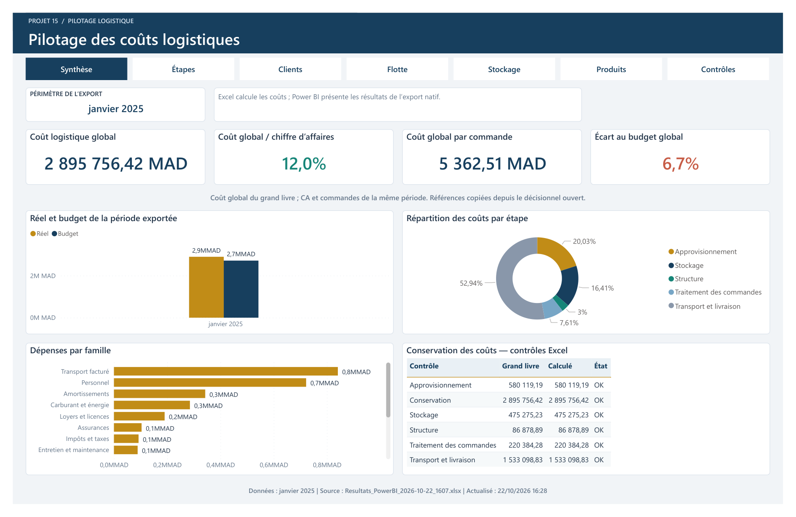

# Pilotage des coûts logistiques — Excel VBA & Power BI

Projet académique du **Groupe 9 — Projet 15**, présenté en soutenance en octobre 2026.

Une solution de gestion et d'aide à la décision qui relie deux applications **Excel VBA** à un rapport **Power BI**. Les applications Excel gèrent les données et calculent les coûts ; Power BI présente les résultats pour analyser l'activité logistique.



[Consulter les sept pages du rapport en PDF](Documentation/Apercu_Rapport_PowerBI.pdf) · [Guide d'installation](Documentation/01_INSTALLATION.pdf) · [Documentation du projet](Documentation/Contexte/Contexte_Projet_Groupe9.md)

## Fonctionnalités

- **Gestion logistique dans Excel** : saisie, référentiels, contrôles et clôture des périodes.
- **Application décisionnelle VBA** : import des données, calcul et analyse des coûts, simulation et export des résultats.
- **Rapport Power BI de sept pages** : Synthèse, Étapes, Clients, Flotte, Stockage, Produits et Contrôles.
- **Indicateurs** : coût global, chiffre d'affaires, coût par commande, écart au budget, coût au kilomètre, remplissage et occupation des zones.
- **Actualisation depuis Excel** : export natif, actualisation du rapport, comparaison des principaux chiffres et enregistrement du PBIX.

## Fonctionnement

```text
Gestion_Logistique.xlsm
        ↓ import
Decisionnel_Logistique.xlsm
        ↓ calcul des coûts et export
Exports/ : résultats et référentiels Excel
        ↓ chargement et actualisation
Projet15_Rapport_Auto.pbix
```

Le modèle `Projet15_Modele_Auto.pbit` permet de configurer le rapport sur un autre ordinateur en indiquant son dossier `Exports`.

## Contenu du dépôt

| Fichier ou dossier | Contenu |
| --- | --- |
| `Gestion_Logistique.xlsm` | Application de gestion avec macros VBA |
| `Decisionnel_Logistique.xlsm` | Application décisionnelle avec macros VBA |
| `Projet15_Rapport_Auto.pbix` | Rapport Power BI avec données enregistrées |
| `Projet15_Modele_Auto.pbit` | Modèle Power BI configurable pour une autre installation |
| `Exports/` | Export initial des résultats et référentiels |
| `Ouvrir_Actualise.ps1` | Lanceur d'export, d'actualisation et de contrôle |
| `Verifier_PC.ps1`, `Configurer_Connexions.ps1` | Scripts de vérification et de configuration |
| `Documentation/` | Guides HTML/PDF, aperçu du rapport, maquette et contexte |
| `Rapports/` | Inventaire et traces des validations historiques |
| `Technique/` | Notes de maintenance de l'intégration |

## Installation et démarrage

**Prérequis :** Windows 64 bits, Microsoft Excel de bureau avec VBA et Power BI Desktop 64 bits. Le lanceur fourni utilise l'installation classique de Power BI dans `C:\Program Files\Microsoft Power BI Desktop\bin`.

1. Télécharger le dépôt avec **Code → Download ZIP**, puis extraire tout le contenu dans un dossier local accessible en écriture. Il est aussi possible de cloner le dépôt avec Git.
2. Consulter [00_COMMENCER_ICI.pdf](00_COMMENCER_ICI.pdf) et [le guide d'installation](Documentation/01_INSTALLATION.pdf), puis lancer `1_VERIFIER_PC.cmd`.
3. Ouvrir les deux classeurs dans Excel et autoriser les macros pour ces fichiers. Fermer les menus des applications pendant la configuration.
4. Ouvrir `Projet15_Modele_Auto.pbit`, renseigner **DossierExports** avec le chemin complet du dossier `Exports`, puis enregistrer le rapport à la racine sous **`Projet15_Rapport_Auto.pbix`**, en remplaçant la copie fournie. Fermer Power BI.
5. Lancer `2_CONFIGURER_CONNEXIONS.cmd`, puis enregistrer le décisionnel dans Excel avec **Ctrl+S**.
6. Dans le décisionnel, cliquer sur **Ouvrir le rapport Power BI** et attendre la fin de l'actualisation.

Conserver les deux classeurs côte à côte avec leurs noms d'origine. Après un déplacement du dossier, refaire la configuration des connexions. Le fichier PBIX fourni contient les chemins du PC d'origine : utiliser le PBIT pour l'adapter au nouveau PC.

Si PowerShell signale qu'un script téléchargé n'est pas signé, consulter [les instructions de dépannage](Documentation/06_CORRECTIF_CONTROLES.txt). La procédure dépend de la politique d'exécution de l'ordinateur.

## Aperçu des analyses

| Page | Analyse |
| --- | --- |
| Synthèse | Vue d'ensemble des coûts, du chiffre d'affaires et du budget |
| Étapes | Répartition des coûts par étape de la chaîne logistique |
| Clients | Coûts des commandes et analyse par client |
| Flotte | Coût des véhicules, coût au kilomètre et remplissage renseigné |
| Stockage | Coûts de stockage et occupation des zones |
| Produits | Coûts des lignes, volumes et coût par colis |
| Contrôles | Conservation des montants, rapprochements et alertes |

## Données de référence et validation

L'instantané livré et les validations historiques portent sur **janvier 2025** :

| Indicateur | Valeur |
| --- | ---: |
| Coût global | 2 895 756,42 MAD |
| Chiffre d'affaires HT | 24 063 287,19 MAD |
| Nombre de commandes | 540 |
| Budget | 2 714 300,00 MAD |
| Coût moyen par commande | 5 362,51 MAD |

Les preuves conservées dans `Rapports/Preuves_PC_Ayoub/` concernent l'environnement de préparation : concordance des valeurs Excel/Power BI, filtrages, affichage des sept pages et essais d'actualisation rapport ouvert ou fermé. Elles ne remplacent pas une vérification sur un autre ordinateur. Le correctif des contrôles natifs Excel du 22 octobre 2026 est inclus dans le lanceur.

Le coût global de l'entreprise et les coûts affectés aux commandes ont des périmètres différents. Les données manquantes et les périodes non validées sont décrites dans [l'état de la livraison](Documentation/04_ETAT_ET_INVENTAIRE.pdf).

## Documentation

- [Installation et configuration](Documentation/01_INSTALLATION.pdf)
- [Parcours de démonstration](Documentation/02_DEMONSTRATION.pdf)
- [Tests et dépannage](Documentation/03_TESTS_ET_DEPANNAGE.pdf)
- [État de la livraison et inventaire](Documentation/04_ETAT_ET_INVENTAIRE.pdf)
- [Présentation Power BI en dix minutes](Documentation/05_PRESENTATION_POWERBI_10_MIN.pdf)
- [Maintenance technique](Technique/MAINTENANCE.md)

**Technologies :** Microsoft Excel, VBA, Power BI Desktop, Power Query, DAX et Windows PowerShell.
